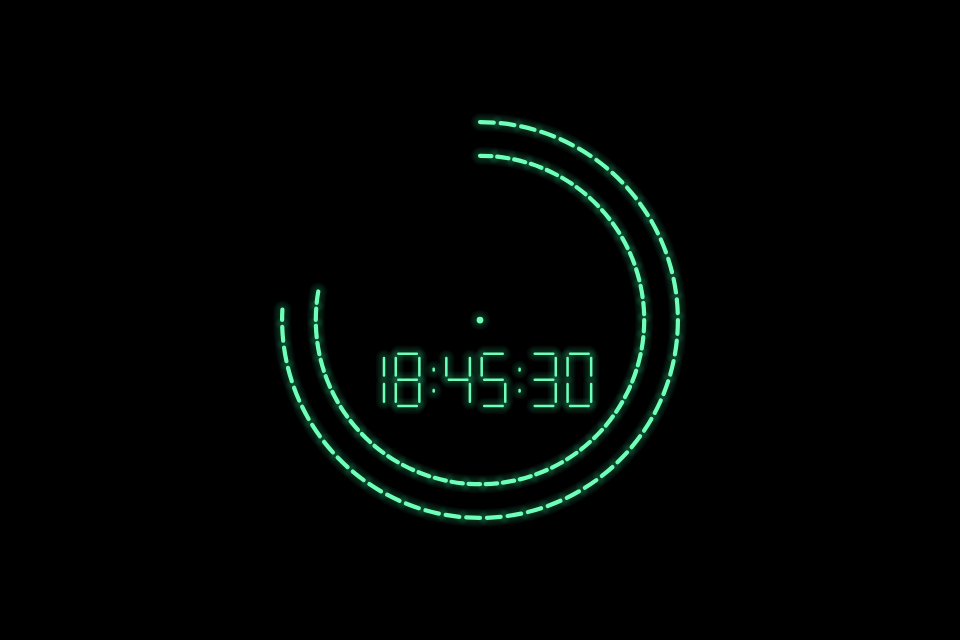
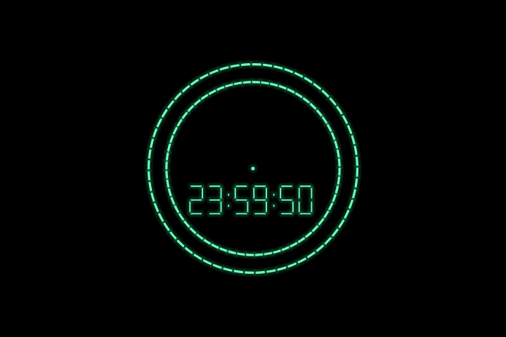
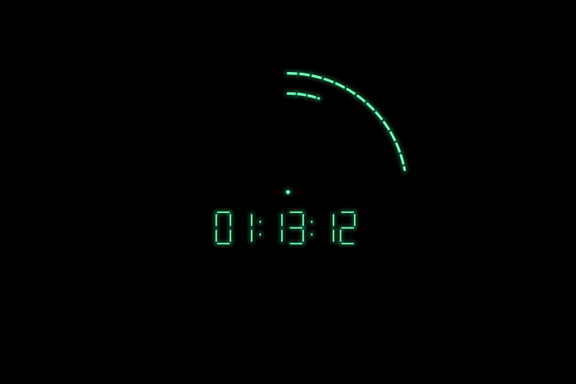

<div align="center">

# Relógio Verde

**O tempo desenhado em luz.**

Protetor de tela para Windows com dois círculos luminosos, um ponto fixo e relógio digital de 24 horas.

[Experimentar no navegador](https://maiconaalmeida.github.io/relogio-verde/) · [Baixar para Windows](https://github.com/maiconaalmeida/relogio-verde/raw/refs/heads/main/downloads/Relogio-Verde-Windows11.zip) · [Como instalar](#instalação-no-windows)



**Windows 11 · HTML + Canvas · C# + Windows Forms · Offline · Licença MIT**

</div>

## A inspiração

A ideia nasceu de uma cena de **American Horror Story, temporada 13, episódio 2**, em que o laptop do personagem **Ben** exibe um relógio verde sobre um fundo escuro. A vontade era simples: ter algo parecido no próprio computador e compartilhar com quem também gostou daquele visual.

Este projeto é uma **recriação independente**, desenvolvida a partir de uma referência visual e de uma interpretação do seu funcionamento. Não é o software original usado na produção. O nome do protetor original não foi identificado, e a lógica dos círculos aqui foi escolhida para esta versão.

O código não inclui imagens, vídeos, logotipos ou outros arquivos extraídos da série. Não há vínculo ou endosso de American Horror Story, FX ou seus titulares.

## Veja em movimento

[](https://maiconaalmeida.github.io/relogio-verde/)

*Demonstração com horário simulado, atravessando 23:59:59 e reiniciando à meia-noite. No uso normal, o relógio acompanha a hora local do computador.*

O README do GitHub não executa JavaScript nem incorpora uma página HTML interativa. Por isso, a prévia acima é um GIF. **[Abra a versão HTML funcionando aqui](https://maiconaalmeida.github.io/relogio-verde/)** para ver a hora atual e usar o botão de tela cheia.

Também é possível abrir `windows/Previa.html` diretamente no navegador, sem instalar e sem internet. A versão HTML é uma exibição de relógio. O acionamento automático por inatividade é uma função da versão nativa para Windows.

## Como ler o relógio

| Elemento | O que representa | Quando reinicia |
| --- | --- | --- |
| Ponto central | Referência visual fixa | Permanece fixo |
| Círculo interno | Progresso das 24 horas do dia | Às 00:00:00 |
| Círculo externo | Progresso dos 60 minutos da hora | A cada hora cheia |
| Digital | Hora local em `HH:MM:SS` | Acompanha o relógio do sistema |

Os círculos começam no alto e avançam no sentido horário. O preenchimento inclui frações de segundo, com atualização a cada 100 ms. Não há um terceiro círculo para os segundos.

Às 06:00, o círculo interno está em 25%. Às 12:00, em 50%. Às 18:00, em 75%. O círculo externo segue a mesma proporção para 15, 30 e 45 minutos.

Na virada, o progresso volta imediatamente a zero. Não existe uma pausa artificial com o círculo completo. Os pequenos espaços entre os segmentos fazem parte do desenho.

<details>
<summary>Outra captura do visual</summary>



Capturas geradas pelo desenho Canvas do projeto com horários simulados. O brilho e a espessura podem variar um pouco entre o navegador e a versão nativa.

</details>

## Instalação no Windows

### 1. Baixe o pacote completo

**[Baixar Relogio-Verde-Windows11.zip](https://github.com/maiconaalmeida/relogio-verde/raw/refs/heads/main/downloads/Relogio-Verde-Windows11.zip)**

Outra opção é usar **Code > Download ZIP** neste repositório e entrar na pasta `windows` após extrair.

### 2. Extraia antes de executar

Clique com o botão direito no ZIP e escolha **Extrair tudo**. Abra a pasta extraída `Relogio-Verde`.

Não execute o instalador de dentro da janela do ZIP. Ele precisa dos demais arquivos que acompanham o pacote.

### 3. Instale

1. Feche uma eventual janela antiga de configurações de proteção de tela.
2. Dê dois cliques em **Instalar.cmd** no seu usuário normal do Windows.
3. Aguarde a compilação, o teste de desenho e a mensagem **INSTALADO**.
4. Execute **Testar.cmd** para abrir o relógio imediatamente.
5. Mova o mouse ou pressione uma tecla para sair.
6. Use **Configuracoes.cmd** para ajustar o tempo de espera e conferir a seleção de **RelogioVerde**.

Não é necessário executar como administrador. O instalador seleciona o protetor para o usuário atual e preserva o tempo de espera positivo existente. Quando não há um tempo válido, usa 5 minutos. A opção de exigir senha ao retornar não é alterada.

### Requisitos

- Windows 11 como ambiente alvo.
- Windows PowerShell 5.1.
- Compilador `csc.exe` do .NET Framework, normalmente disponível no Windows.
- Permissão para executar scripts e programas locais. Políticas de uma organização podem impedir isso.

**O pacote inclui o código completo, mas não um `.scr` pré-compilado.** O instalador gera `RelogioVerde.scr` no próprio computador, sem baixar dependências.

## O que o instalador faz

1. Confere os arquivos necessários e verifica políticas que podem impedir a seleção.
2. Compila o código C# em uma pasta temporária.
3. Executa um teste de desenho nativo antes de instalar.
4. Copia o programa para `%LOCALAPPDATA%\RelogioVerde`.
5. Registra a seleção no perfil do usuário e ativa o protetor pela API do Windows.
6. Verifica a seleção e abre as configurações do sistema.

O aplicativo não usa rede, não tem anúncios nem coleta dados. O script usa uma política de execução temporária apenas naquele processo do PowerShell, sem alterar a política permanentemente. Nenhuma configuração de senha é desativada.

## Atualização e desinstalação

**Atualizar:** extraia o pacote novo e execute `Instalar.cmd` novamente. Feche o protetor antes de atualizar. O arquivo instalado é substituído na mesma pasta.

**Desinstalar:** execute `Desinstalar.cmd`. A seleção anterior é restaurada quando houver um registro válido feito pelo instalador 2.1. Os logs de diagnóstico são preservados.

## Estrutura do projeto

| Caminho | Conteúdo |
| --- | --- |
| `windows/` | Código C#, instalação, teste, desinstalação e prévia offline |
| `docs/index.html` | Versão interativa publicada no GitHub Pages |
| `docs/assets/` | Capturas e animação utilizadas neste README |
| `downloads/` | Pacote completo para instalação |
| `tests/` | Verificações da lógica de tempo da versão HTML |
| `.github/workflows/` | Validação de scripts, compilação e desenho no Windows |

## Desenvolvimento e validação

A implementação nativa usa C# e Windows Forms com desenho via GDI+. A versão web usa HTML, CSS e Canvas sem bibliotecas externas. As duas implementações seguem as mesmas proporções de tempo.

Para testar a lógica de tempo com Node.js:

```sh
node tests/clock.test.cjs
```

O workflow `Validar relógio` verifica a sintaxe dos scripts PowerShell, compila o programa e gera uma imagem no runner Windows. O resultado de cada execução pode ser consultado na aba **Actions**. Esse teste não substitui a verificação da instalação, das políticas do sistema, da ativação por inatividade e de múltiplos monitores em um computador real.

A exibição da versão 2.1 em um computador Windows foi confirmada pelo autor durante o desenvolvimento. Isso não significa que todas as versões e configurações de Windows tenham sido testadas.

## Créditos e licença

Projeto idealizado por **Maicon A Almeida**, com ajustes a partir de testes no Windows.

Código disponibilizado sob a [licença MIT](LICENSE). Você pode usar, estudar, modificar e compartilhar. Os nomes e marcas citados como referência não estão incluídos nessa licença.
